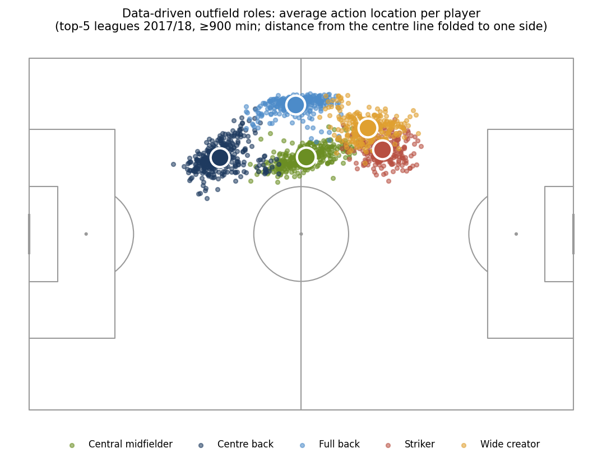
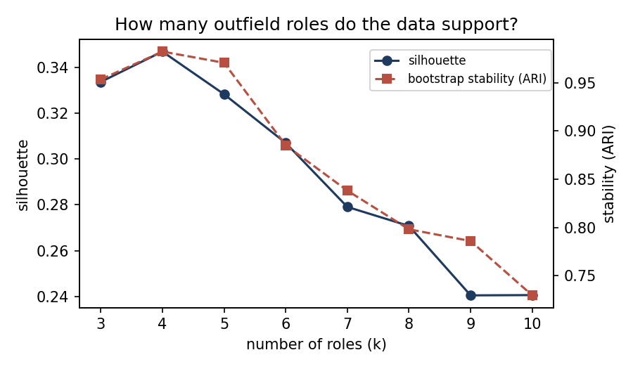
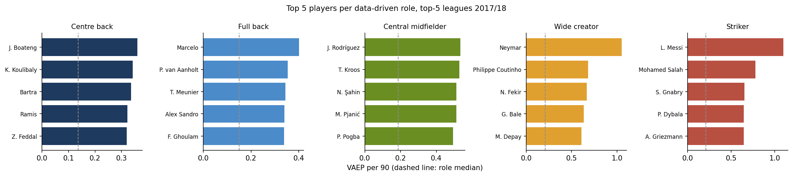

# Data-driven player roles from event data

Official positions (GK / DF / MF / FW) say little about *how* a player plays.
This project derives outfield roles directly from Wyscout event data for the
top-5 European leagues (2017/18) and ranks players within the role they
actually play, using VAEP action values.

## Approach

1. **Event data → SPADL → VAEP.** 3.07M Wyscout events from 1,826 matches are
   converted to SPADL actions with `socceraction`. Two XGBoost models estimate
   the probability that the acting team scores / concedes within the next 10
   actions. Predictions are **out-of-fold by match** (5-fold GroupKFold), so every
   action is valued by a model that never saw its game
   (AUC 0.78 for scoring, 0.74 for conceding).
2. **Player profiles.** For every player with ≥ 900 minutes (1,665 players):
   average action location (depth and distance from the centre line, with all
   actions oriented in the team's attacking direction) and the share of passes,
   crosses, dribbles, shots, defensive actions, progressive passes and actions
   in the final third.
3. **How many roles?** K-means on the standardised profiles of outfield players,
   with k chosen by silhouette **and** bootstrap stability (adjusted Rand index
   over 30 resamples). k = 4 and 5 are the most stable; from k = 6 the
   clusters stop being reproducible.

   
4. **Rankings within role.** VAEP per 90 compared only against players in the
   same role.

## Findings

| Role | Players | Most-used players |
|---|---|---|
| Centre back | 354 | Acerbi, Maguire, Škriniar |
| Full back | 302 | Zabaleta, Bertrand, Guilbert |
| Central midfielder | 352 | Kessié, Xhaka, Doucouré |
| Wide creator | 286 | Perišić, Eriksen, Callejón |
| Striker | 250 | Vardy, Kane, Gerard Moreno |

- **The "Wide creator" role cuts across official positions:** 190 of its players
  are listed by Wyscout as midfielders and 89 as forwards. The official labels
  split one footballing role into two.
- The roles are nested: going from k = 4 to k = 5 splits the attacking cluster
  into wide creators and strikers, leaving the other roles unchanged.
- Roles follow how players were used, not their listed position: Hazard,
  playing as a false nine under Conte, is placed among the strikers.

## Limitations and next steps

- VAEP per 90 is noisy for players with fewer minutes (several top-10 entries
  have 1,000–1,300 minutes); minutes-aware shrinkage is the next step.
- VAEP values on-ball actions, so centre backs who progress the ball rank above
  pure defenders.
- One season, one data provider.

This repository is part of my doctoral research in sports analytics at the
University of Piraeus. An extended analysis of cross-league player evaluation
building on this pipeline is being prepared for journal publication.

## Reproduce

Run `football-player-roles.ipynb` on Kaggle with the public Wyscout dataset
(Pappalardo et al., 2019) attached. Runtime ≈ 25 min on CPU.

## Data and references

- Pappalardo, L. et al. (2019). A public data set of spatio-temporal match
  events in soccer competitions. *Scientific Data*, 6, 236.
- Decroos, T. et al. (2019). Actions speak louder than goals: Valuing player
  actions in soccer. *KDD 2019*.

`results/player_roles_2017_18.csv`: every player with his data-driven role,
profile and VAEP per 90. `results/top10_per_role.csv`: top 10 per role.
